<picture><source media="(prefers-color-scheme: dark)" srcset="./assets/header-dark.svg"></picture>

CSE undergrad · full-stack & AI/ML engineer · from Rust interpreters to government CMS & LMS platforms. Ex-cybersecurity & reverse engineering — now building LLM apps and AI agents.

<a href="https://arxhr007.github.io/"><picture><source media="(prefers-color-scheme: dark)" srcset="https://img.shields.io/badge/portfolio-%E2%86%97-ffffff?style=flat-square&labelColor=ffffff"></picture></a>
<a href="https://arxhr007.vercel.app"><picture><source media="(prefers-color-scheme: dark)" srcset="https://img.shields.io/badge/personal-%E2%86%97-ffffff?style=flat-square&labelColor=ffffff"></picture></a>
<a href="https://arxhr007.github.io/blog"><picture><source media="(prefers-color-scheme: dark)" srcset="https://img.shields.io/badge/blog-%E2%86%97-ffffff?style=flat-square&labelColor=ffffff"></picture></a>
<a href="https://arxhr007.github.io/Aaron_Thomas.pdf"><picture><source media="(prefers-color-scheme: dark)" srcset="https://img.shields.io/badge/resume-%E2%86%97-ffffff?style=flat-square&labelColor=ffffff"></picture></a>

<picture><source media="(prefers-color-scheme: dark)" srcset="./assets/divider-dark.svg"></picture>

<picture><source media="(prefers-color-scheme: dark)" srcset="./assets/s-projects-dark.svg"></picture>

<table>
<tr>
<td align="center" width="33%" valign="top"> <picture><source media="(prefers-color-scheme: dark)" srcset="./assets/i-eye-dark.svg"></picture> <a href="https://github.com/arxhr007/Aliens_eye"><b>Aliens-Eye</b></a> AI-powered OSINT engine mapping 7,700+ social identities <code>python · bash</code>  </td>
<td align="center" width="33%" valign="top"> <picture><source media="(prefers-color-scheme: dark)" srcset="./assets/i-term-dark.svg"></picture> <a href="https://github.com/arxhr007/lxask"><b>lxask</b></a> Offline Linux command assistant — 1.5B local model, no GPU, ~2s/answer <code>rust · llama.cpp · lora</code>  </td>
<td align="center" width="33%" valign="top"> <picture><source media="(prefers-color-scheme: dark)" srcset="./assets/i-book-dark.svg"></picture> <a href="https://github.com/arxhr007/neurolearn"><b>NeuroLearn</b></a> Malayalam adaptive AI tutor for neurodivergent learners <code>fastapi · langgraph · chromadb</code>  </td>
</tr>
<tr>
<td align="center" width="33%" valign="top"> <picture><source media="(prefers-color-scheme: dark)" srcset="./assets/i-braces-dark.svg"></picture> <a href="https://github.com/arxhr007/amma"><b>Amma</b></a> A Malayalam programming language & interpreter <code>rust</code>  </td>
<td align="center" width="33%" valign="top"> <picture><source media="(prefers-color-scheme: dark)" srcset="./assets/i-cube-dark.svg"></picture> <a href="https://github.com/arxhr007/Sandbox-Detection-Techniques"><b>Sandbox-Detection</b></a> Advanced sandbox / VM detection techniques <code>c</code>  </td>
<td align="center" width="33%" valign="top"> <picture><source media="(prefers-color-scheme: dark)" srcset="./assets/i-wifi-dark.svg"></picture> <a href="https://github.com/arxhr007/wifistrike"><b>Wifi-Strike</b></a> Pure-Python automated WiFi deauther & packet injection <code>python</code>  </td>
</tr>
</table>

<picture><source media="(prefers-color-scheme: dark)" srcset="./assets/s-top-dark.svg"></picture>

<table>
<tr><td align="center" width="64"><picture><source media="(prefers-color-scheme: dark)" srcset="./assets/i-apacheairflow-dark.svg"></picture></td><td><a href="https://github.com/apache/airflow/pull/76142"><b>apache/airflow</b> #76142</a> &nbsp; Secrets masker leaked part of a secret when another secret was its prefix — the whole value is now masked in logs.</td></tr>
<tr><td align="center" width="64"><picture><source media="(prefers-color-scheme: dark)" srcset="./assets/i-llama-dark.svg"></picture></td><td><a href="https://github.com/ggml-org/llama.cpp/pull/31631"><b>ggml-org/llama.cpp</b> #31631</a> &nbsp; <code>gguf-py</code> validates every tokenizer merge pair instead of only the first, catching malformed GGUF files early.</td></tr>
<tr><td align="center" width="64"><picture><source media="(prefers-color-scheme: dark)" srcset="./assets/i-apachekafka-dark.svg"></picture></td><td><a href="https://github.com/apache/kafka/pull/24069"><b>apache/kafka</b> #24069</a> &nbsp; <code>ByteBufferAccessor</code> now rejects negative sizes, hardening protocol message deserialization.</td></tr>
<tr><td align="center" width="64"><picture><source media="(prefers-color-scheme: dark)" srcset="./assets/i-redis-dark.svg"></picture></td><td><a href="https://github.com/redis/redis-py/pull/4556"><b>redis/redis-py</b> #4556</a> &nbsp; <code>CLIENT LIST</code> is split on newlines only, so fields with other line-break characters no longer corrupt parsing.</td></tr>
<tr><td align="center" width="64"><picture><source media="(prefers-color-scheme: dark)" srcset="./assets/i-docker-dark.svg"></picture></td><td><a href="https://github.com/docker/docker-agent/pull/4787"><b>docker/docker-agent</b> #4787</a> &nbsp; Safety classifier no longer auto-approves <code>sort</code> / <code>tree</code> with option operands that can write files.</td></tr>
</table>

<picture><source media="(prefers-color-scheme: dark)" srcset="./assets/s-more-dark.svg"></picture>

<table>
<tr>
<td align="center" width="25%"><b>awslabs/llrt</b> <a href="https://github.com/awslabs/llrt/pull/1864">#1864</a> · <a href="https://github.com/awslabs/llrt/pull/1865">#1865</a></td>
<td align="center" width="25%"><b>VirusTotal/yara-x</b> <a href="https://github.com/VirusTotal/yara-x/pull/833">#833</a> · <a href="https://github.com/VirusTotal/yara-x/pull/829">#829</a></td>
<td align="center" width="25%"><b>radareorg/radare2</b> <a href="https://github.com/radareorg/radare2/pull/27203">#27203</a> · <a href="https://github.com/radareorg/radare2/pull/27204">#27204</a></td>
<td align="center" width="25%"><b>python-pillow/Pillow</b> <a href="https://github.com/python-pillow/Pillow/pull/10381">#10381</a></td>
</tr>
<tr>
<td align="center" width="25%"><b>projectdiscovery/nuclei</b> <a href="https://github.com/projectdiscovery/nuclei/pull/7959">#7959</a></td>
<td align="center" width="25%"><b>projectdiscovery/httpx</b> <a href="https://github.com/projectdiscovery/httpx/pull/2693">#2693</a></td>
<td align="center" width="25%"><b>projectdiscovery/subfinder</b> <a href="https://github.com/projectdiscovery/subfinder/pull/1986">#1986</a></td>
<td align="center" width="25%"><b>bettercap/bettercap</b> <a href="https://github.com/bettercap/bettercap/pull/1313">#1313</a></td>
</tr>
<tr>
<td align="center" width="25%"><b>strace/strace</b> <a href="https://github.com/strace/strace/pull/434">#434</a></td>
<td align="center" width="25%"><b>mvt-project/mvt</b> <a href="https://github.com/mvt-project/mvt/pull/984">#984</a></td>
<td align="center" width="25%"><b>frida/frida-tools</b> <a href="https://github.com/frida/frida-tools/pull/209">#209</a></td>
<td align="center" width="25%"><b>fastfetch-cli/fastfetch</b> <a href="https://github.com/fastfetch-cli/fastfetch/pull/2694">#2694</a> · <a href="https://github.com/fastfetch-cli/fastfetch/pull/2695">#2695</a> · <a href="https://github.com/fastfetch-cli/fastfetch/pull/2696">#2696</a></td>
</tr>
<tr>
<td align="center" width="25%"><b>otel-collector-contrib</b> <a href="https://github.com/open-telemetry/opentelemetry-collector-contrib/pull/52648">#52648</a></td>
<td align="center" width="25%"><b>awslabs/documentdb-tools</b> <a href="https://github.com/awslabs/amazon-documentdb-tools/pull/217">#217</a></td>
<td align="center" width="25%"><b>graphql-python/graphql-core</b> <a href="https://github.com/graphql-python/graphql-core/pull/295">#295</a></td>
<td align="center" width="25%"><b>TabularisDB/tabularis</b> <a href="https://github.com/TabularisDB/tabularis/pull/1355">#1355</a></td>
</tr>
<tr>
<td align="center" width="25%"><b>Orkas-AI/Orkas</b> <a href="https://github.com/Orkas-AI/Orkas/pull/140">#140</a></td>
<td align="center" width="25%"><b>KnockOutEZ/wigolo</b> <a href="https://github.com/KnockOutEZ/wigolo/pull/667">#667</a></td>
<td width="25%"></td>
<td width="25%"></td>
</tr>
</table>

<picture><source media="(prefers-color-scheme: dark)" srcset="./assets/footer-dark.svg"></picture>

